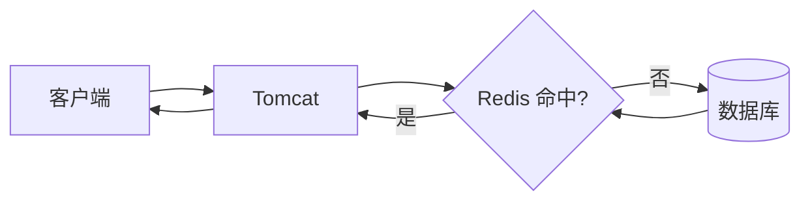
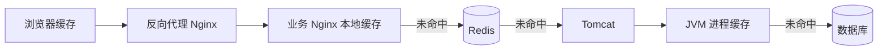
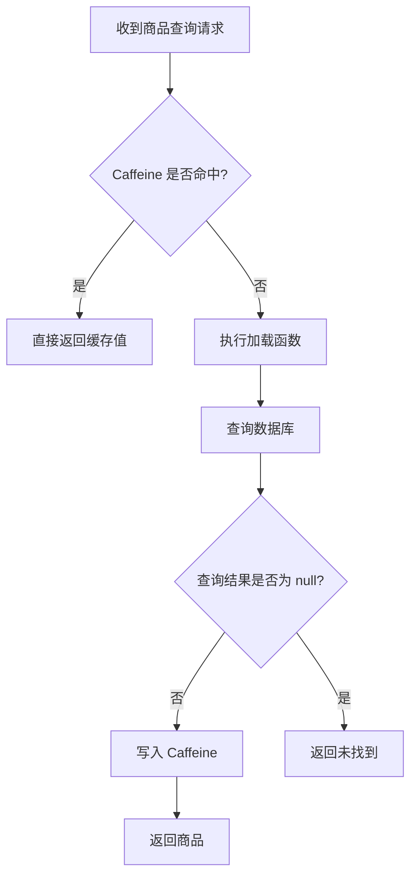
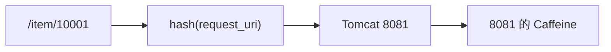
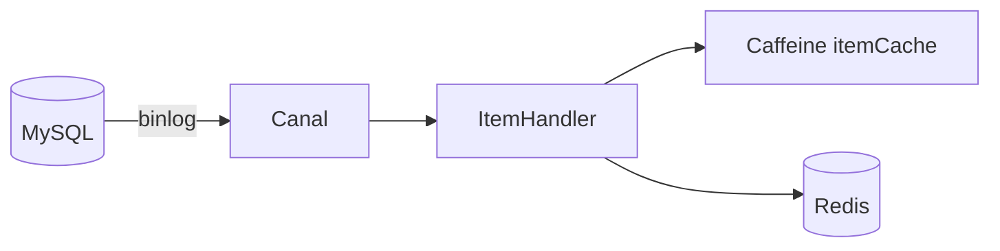

## 1. 为什么需要多级缓存

### 1.1 传统缓存方案

传统查询链路通常是：



这种方案虽然已经通过 Redis 减少了数据库访问，但仍然存在两个突出问题：

1. **所有动态请求都必须经过 Tomcat**  
   当并发持续升高时，Tomcat 的线程、CPU、连接池等资源可能成为系统瓶颈。

2. **Redis 未命中会把压力继续传给数据库**  
   缓存过期、冷启动或热点 Key 失效时，大量请求可能同时访问数据库。

### 1.2 多级缓存方案

多级缓存会充分利用请求链路中的各层存储能力：



典型查询顺序如下：

1. 浏览器访问静态资源时，优先读取浏览器缓存；
2. 动态请求到达 Nginx 后，优先查询 Nginx 本地缓存；
3. Nginx 本地缓存未命中时，查询 Redis；
4. Redis 未命中时，请求 Tomcat；
5. Tomcat 优先查询 JVM 进程缓存；
6. JVM 进程缓存未命中时，最后查询数据库。

这样可以逐层拦截请求，减少对后端服务和数据库的访问。

### 1.3 各层缓存的职责

| 缓存层级 | 典型内容 | 优点 | 主要限制 |
|---|---|---|---|
| 浏览器缓存 | HTML、CSS、JS、图片等静态资源 | 距离用户最近，命中后不访问服务端 | 受浏览器缓存策略控制 |
| Nginx 本地缓存 | 热点接口结果 | 延迟低，可在进入 Java 服务前返回 | 多节点之间需要处理数据一致性 |
| Redis | 跨实例共享的热点数据 | 容量较大、可共享、可持久化和高可用 | 存在网络和序列化开销 |
| JVM 进程缓存 | 单个 Java 实例中的高频小数据 | 直接读取本机内存，速度快 | 容量有限、进程重启丢失、实例间不共享 |
| 数据库 | 最终业务数据 | 持久化、查询能力完整 | 承载高并发读的成本较高 |

在课程架构中，承担业务查询和缓存逻辑的 Nginx 已不只是反向代理服务器，而是一个可通过 OpenResty 与 Lua 编写业务逻辑的 Web 服务。因此通常会把它部署成集群，并在前面再设置专门的反向代理 Nginx。

---

## 2. JVM 进程缓存

### 2.1 什么是进程缓存

JVM 进程缓存是保存在当前 Java 进程堆内存中的数据。常见实现包括：

- `HashMap`；
- `ConcurrentHashMap`；
- Guava Cache；
- Caffeine。

与普通 `Map` 相比，专业缓存库通常还提供：

- 最大容量控制；
- 基于时间的过期；
- 自动加载；
- 并发访问控制；
- 驱逐策略；
- 命中率、加载耗时等统计；
- 移除监听、异步刷新等扩展能力。

### 2.2 进程缓存与 Redis 的区别

| 对比维度 | JVM 进程缓存 | Redis 分布式缓存 |
|---|---|---|
| 数据位置 | 当前应用进程内存 | 独立 Redis 服务 |
| 访问成本 | 无网络开销，通常更快 | 有网络与序列化开销 |
| 数据共享 | 不同应用实例之间不共享 | 多个实例可以共享 |
| 容量 | 受 JVM 堆大小限制 | 可独立扩容，容量通常更大 |
| 可靠性 | 进程停止后数据丢失 | 可通过持久化、主从、集群提高可靠性 |
| 一致性 | 每个实例可能保存不同版本 | 集中存储，更容易统一管理 |
| 适用场景 | 数据量小、访问极频繁、允许短暂不一致 | 数据量较大、需要跨实例共享 |

二者不是互相替代的关系。常见做法是把 Caffeine 作为一级缓存（L1），把 Redis 作为二级缓存（L2）。

### 2.3 进程缓存的边界

使用 JVM 进程缓存时要明确：

- **每个 Tomcat 实例都有自己的缓存副本**；
- 请求被负载均衡到不同实例时，可能连续发生多次未命中；
- 实例扩容后，新实例的缓存是空的；
- 应用重启后，缓存会全部丢失；
- 数据更新后，需要考虑所有实例中旧值的失效问题；
- 缓存对象会占用 JVM 堆，容量失控可能增加 GC 压力，甚至导致 OOM。

因此，进程缓存适合保存“体积较小、访问频繁、可重新加载”的数据，不应充当可靠的最终数据源。

---

## 3. 初识 Caffeine

### 3.1 Caffeine 的定位

Caffeine 是 Java 平台上的高性能本地缓存库，提供手动缓存、同步加载缓存和异步缓存等模式。

Spring Framework 提供了对 Caffeine 的适配，可以通过 `CaffeineCache`、`CaffeineCacheManager` 或 Spring Cache 注解使用它。需要注意：**Spring 的缓存模块是一层抽象，Caffeine 是它支持的具体缓存实现之一，不能简单理解为“Spring 内部默认缓存就是 Caffeine”。**

官方资料：

- [Caffeine GitHub](https://github.com/ben-manes/caffeine)
- [Caffeine Population：缓存加载方式](https://github.com/ben-manes/caffeine/wiki/Population)
- [Caffeine Eviction：驱逐策略](https://github.com/ben-manes/caffeine/wiki/Eviction)
- [Spring Framework CaffeineCache API](https://docs.spring.io/spring-framework/docs/current/javadoc-api/org/springframework/cache/caffeine/CaffeineCache.html)

#### 项目依赖

使用 Spring Boot `2.3.9.RELEASE` 和 Java 8，并直接引入 Caffeine：

```xml
<dependency>
    <groupId>com.github.ben-manes.caffeine</groupId>
    <artifactId>caffeine</artifactId>
</dependency>
```

该工程继承 Spring Boot 父 POM，因此依赖没有单独声明版本。若脱离这个父 POM 使用，需要在自己的依赖管理中明确一个与当前 Java 版本兼容的 Caffeine 版本。

### 3.2 基本 API

```java
@Test
void testBasicOps() {
    // 1. 创建手动缓存。未配置过期或容量时，缓存可能持续增长。
    Cache<String, String> cache = Caffeine.newBuilder()
            .maximumSize(100)
            .build();

    // 2. 写入或覆盖
    cache.put("name", "Caffeine");

    // 3. 只查询缓存；未命中返回 null
    String value = cache.getIfPresent("name");

    // 4. 查询缓存；未命中时执行加载函数，并把非 null 结果写入缓存
    String loaded = cache.get("language", key -> {
        // 实际业务中可以在这里查询数据库或调用下一级缓存
        return "Java";
    });

    // 5. 删除单个 Key
    cache.invalidate("name");

    // 6. 清空缓存
    cache.invalidateAll();
}
```

常用方法：

| 方法 | 作用 |
|---|---|
| `getIfPresent(key)` | 只查询缓存，未命中时返回 `null` |
| `get(key, mappingFunction)` | 未命中时计算并写入，然后返回结果 |
| `put(key, value)` | 新增或覆盖缓存 |
| `invalidate(key)` | 使指定 Key 失效 |
| `invalidateAll()` | 使全部缓存失效 |
| `estimatedSize()` | 返回缓存条目数的估算值 |
| `stats()` | 获取命中率、加载耗时、驱逐次数等统计信息 |

同一个测试类的容量驱逐案例使用 `Thread.sleep(10L)` 等待维护任务，这会让测试依赖机器调度。需要稳定断言时，可在写入后调用 `cache.cleanUp()` 触发待执行的维护，再检查条目或统计信息。

### 3.3 为什么优先使用 `cache.get`

不要把“先判断，再加载，再写入”拆成三个独立步骤：

```java
// 不推荐：并发请求可能同时发现缓存未命中，然后重复查询数据库
Item item = cache.getIfPresent(id);
if (item == null) {
    item = itemService.getById(id);
    cache.put(id, item);
}
return item;
```

更推荐：

```java
return cache.get(id, itemService::getById);
```

`cache.get(key, mappingFunction)` 会以原子方式完成“未命中时计算并写入”。同一个 JVM 内并发访问同一 Key 时，它能减少重复加载，缓解本机范围内的缓存击穿。

但它只能协调**当前进程**中的线程，不能阻止其他 Tomcat 实例同时回源。如果需要跨实例控制热点 Key 的并发回源，还需要 Redis 锁、逻辑过期、请求合并等分布式方案。

### 3.4 空值与异常

加载函数可能查询不到数据，也可能抛出异常：

```java
Item item = itemCache.get(id, key -> itemService.getById(key));
```

需要注意：

- 加载函数返回 `null` 时，不会形成一个正常的 Caffeine 缓存条目；
- 如果热点请求持续查询一个不存在的 ID，仍可能反复访问数据库，这就是缓存穿透；
- 加载函数抛出异常时，异常会向调用方传播，不应把系统错误当作正常数据缓存；
- 可以缓存一个明确的空对象或包装类型，并设置较短有效期，但不能直接把“数据不存在”和“查询失败”混为一谈。

例如：

```java
record CacheValue<T>(boolean found, T data) {
    static <T> CacheValue<T> hit(T data) {
        return new CacheValue<>(true, data);
    }

    static <T> CacheValue<T> notFound() {
        return new CacheValue<>(false, null);
    }
}
```

---

## 4. Caffeine 的驱逐与过期策略

缓存必须有边界，否则可能不断占用内存。

### 4.1 基于容量

```java
Cache<Long, Item> cache = Caffeine.newBuilder()
        .initialCapacity(100)
        .maximumSize(10_000)
        .build();
```

- `initialCapacity(100)`：初始容量提示，用于减少早期扩容，不是最小容量，也不是上限；
- `maximumSize(10_000)`：最多保留约 10,000 个条目；
- 达到上限后，Caffeine 会根据访问频率与近期访问情况选择条目驱逐；
- `maximumSize` 限制的是**条目数量**，不是内存字节数。

如果不同条目的内存大小差异很大，可以考虑 `maximumWeight` 与 `weigher`：

```java
Cache<Long, byte[]> cache = Caffeine.newBuilder()
        .maximumWeight(10 * 1024 * 1024)
        .weigher((Long key, byte[] value) -> value.length)
        .build();
```

这里的权重由业务定义，不等同于 JVM 对象的精确内存占用。

### 4.2 基于时间

#### 写入后过期

```java
Cache<Long, Item> cache = Caffeine.newBuilder()
        .expireAfterWrite(Duration.ofMinutes(10))
        .maximumSize(10_000)
        .build();
```

`expireAfterWrite` 从条目创建或最近一次值替换开始计时，适合“写入一段时间后数据可能变旧”的场景。

#### 访问后过期

```java
Cache<Long, Item> cache = Caffeine.newBuilder()
        .expireAfterAccess(Duration.ofMinutes(10))
        .maximumSize(10_000)
        .build();
```

`expireAfterAccess` 从最近一次读或写开始计时，适合会话数据或长期不访问即可淘汰的数据。

两者区别：

| 策略 | 计时起点 | 适合场景 |
|---|---|---|
| `expireAfterWrite` | 创建或最近一次替换 | 控制数据的新鲜度 |
| `expireAfterAccess` | 最近一次读或写 | 清理长期不访问的数据 |

### 4.3 基于引用

Caffeine 支持弱引用 Key、弱引用 Value 和软引用 Value，但这类策略依赖 GC，回收时间和容量都不够可预测。通常更推荐使用明确的 `maximumSize` 或 `maximumWeight`。

### 4.4 过期不等于立即删除

默认情况下，条目到达过期时间后，不一定会在那个时间点被后台线程立即物理删除。清理通常在写操作、部分读操作或维护任务中完成。

因此应这样理解：

- 过期条目不会再作为有效命中返回；
- `estimatedSize()` 在维护完成前可能仍包含等待清理的条目；
- 不要用缓存内部条目是否已物理删除，替代业务上的过期判断。

如果业务要求更及时地执行过期维护，可按所用 Java 与 Caffeine 版本评估 `scheduler` 配置。

### 4.5 刷新与过期的区别

`refreshAfterWrite` 和 `expireAfterWrite` 语义不同：

- **过期**：旧值失效，后续请求通常要等待新值加载；
- **刷新**：条目达到刷新条件后，在被访问时异步加载新值，刷新期间仍可返回旧值。

刷新适合允许短时间旧数据、但希望降低重新加载等待时间的场景。它通常用于 `LoadingCache`，并需要谨慎设计加载线程池、失败回退和数据一致性。

---

## 5. 使用 Caffeine 实现商品进程缓存

### 5.1 需求

给商品服务增加两组 JVM 进程缓存：

- 根据 ID 查询商品，未命中时查询数据库；
- 根据 ID 查询库存，未命中时查询数据库；
- 初始容量为 100；
- 最大条目数为 10,000。

商品与库存应使用不同缓存，原因包括：

- 数据类型不同；
- 更新频率不同；
- 过期时间可能不同；
- 需要分别统计命中率和执行失效操作。

### 5.2 定义缓存 Bean

```java
@Configuration
public class CaffeineConfig {

    @Bean
    public Cache<Long, Item> itemCache() {
        return Caffeine.newBuilder()
                .initialCapacity(100)
                .maximumSize(10_000)
                .build();
    }

    @Bean
    public Cache<Long, ItemStock> stockCache() {
        return Caffeine.newBuilder()
                .initialCapacity(100)
                .maximumSize(10_000)
                .build();
    }
}
```

上面是符合需求的最小实现。生产环境通常还应评估：

- 是否配置过期时间；
- 商品和库存是否采用不同有效期；
- 是否需要 `recordStats()`；
- 是否添加 `removalListener`；
- 最大条目数是否适合对象体积和 JVM 堆大小。

例如：

```java
@Bean
public Cache<Long, Item> itemCache() {
    return Caffeine.newBuilder()
            .initialCapacity(100)
            .maximumSize(10_000)
            .expireAfterWrite(Duration.ofMinutes(10))
            .recordStats()
            .build();
}
```

### 5.3 在 Controller 中查询缓存

```java
@RestController
@RequestMapping("item")
public class ItemController {

    private final IItemService itemService;
    private final IItemStockService stockService;
    private final Cache<Long, Item> itemCache;
    private final Cache<Long, ItemStock> stockCache;

    public ItemController(
            IItemService itemService,
            IItemStockService stockService,
            Cache<Long, Item> itemCache,
            Cache<Long, ItemStock> stockCache) {
        this.itemService = itemService;
        this.stockService = stockService;
        this.itemCache = itemCache;
        this.stockCache = stockCache;
    }

    @GetMapping("/{id}")
    public Item findById(@PathVariable Long id) {
        return itemCache.get(id, key -> itemService.query()
                .ne("status", 3)
                .eq("id", key)
                .one());
    }

    @GetMapping("/stock/{id}")
    public ItemStock findStockById(@PathVariable Long id) {
        return stockCache.get(id, stockService::getById);
    }
}
```

这里改用构造器注入，依赖关系更明确，也更方便测试。

### 5.4 查询流程



第一次请求某个 ID 时：

1. Caffeine 未命中；
2. 执行加载函数；
3. 查询数据库；
4. 将非空结果写入当前 JVM 的缓存；
5. 返回结果。

后续请求命中同一 Tomcat 实例时，可以直接从内存返回。

### 5.5 Tomcat 集群中的命中率

课程后续会启动两个 Tomcat 实例，例如 `8081` 和 `8082`。如果 OpenResty 对它们使用轮询：

```text
第一次查询 /item/10001 → 8081，建立 8081 的本地缓存
第二次查询 /item/10001 → 8082，8082 仍需查询数据库
第三次查询 /item/10001 → 8081，命中
```

因此课程使用请求 URI 做哈希，让同一商品尽量落到同一实例：

```nginx
upstream tomcat-cluster {
    hash $request_uri;
    server 192.168.150.1:8081;
    server 192.168.150.1:8082;
}

location /item {
    proxy_pass http://tomcat-cluster;
}
```

其目标是提高 JVM 进程缓存命中率：



但需要区分两个问题：

- **固定路由解决的是命中率问题**；
- **缓存同步解决的是数据一致性问题**。

哈希路由不会让两个 JVM 共享缓存，也不会自动删除其他实例中的旧值。Tomcat 节点数量变化时，映射还可能重新分布，新节点仍会经历冷缓存。

---

## 6. 数据更新与缓存一致性

只实现查询缓存还不完整。商品或库存发生修改时，旧缓存可能继续被读取。

### 6.1 常用处理策略

| 策略 | 做法 | 特点 |
|---|---|---|
| 设置有效期 | 到期后自动失效，再次查询时重新加载 | 简单，但过期前可能读到旧值 |
| 更新缓存 | 数据库修改成功后写入新缓存值 | 时效性强，但并发和失败处理复杂 |
| 删除缓存 | 数据库修改成功后使缓存失效 | 实现简单，下次查询自然回源 |
| 事件通知 | 修改成功后发布事件，各实例删除或更新本地缓存 | 适合集群，但要处理消息丢失与重试 |

当前服务是单实例时，可以在数据库更新成功后删除对应 Key：

```java
public void updateItem(Item item) {
    itemService.updateById(item);
    itemCache.invalidate(item.getId());
}
```

集群部署时，只删除当前实例的 Caffeine 缓存还不够。其他实例仍可能保留旧值，需要借助：

- Redis Pub/Sub；
- 消息队列；
- Canal 或数据库变更事件；
- 配置中心或专门的缓存失效通道；
- 较短 TTL 作为最终兜底。

### 6.2 商品与库存应区别对待

库存更新通常比商品基本信息更频繁，对时效性要求也更高。因此可以考虑：

- 商品信息采用较长 TTL；
- 库存采用较短 TTL；
- 对库存变更主动发送失效通知；
- 对强一致性库存扣减，不把本地缓存值当作最终扣减依据。

### 6.3 Canal 同步实现

采用 Canal 监听 MySQL binlog，再更新 Caffeine 与 Redis。核心逻辑如下：

```java
@CanalTable("tb_item")
@Component
public class ItemHandler implements EntryHandler<Item> {

    @Autowired
    private RedisHandler redisHandler;
    @Autowired
    private Cache<Long, Item> itemCache;

    @Override
    public void insert(Item item) {
        itemCache.put(item.getId(), item);
        redisHandler.saveItem(item);
    }

    @Override
    public void update(Item before, Item after) {
        itemCache.put(after.getId(), after);
        redisHandler.saveItem(after);
    }

    @Override
    public void delete(Item item) {
        itemCache.invalidate(item.getId());
        redisHandler.deleteItemById(item.getId());
    }
}
```

对应配置位于完成版 `application.yml`：

```yaml
canal:
  destination: aron
  server: 192.168.150.101:11111
```

处理链路是：



这种方案降低了业务写接口与缓存维护代码之间的耦合，但属于异步同步，数据库提交与缓存更新之间仍可能存在短暂时间窗。

---

## 7. 监控、测试与调优

### 7.1 开启统计

```java
Cache<Long, Item> itemCache = Caffeine.newBuilder()
        .maximumSize(10_000)
        .recordStats()
        .build();

System.out.println(itemCache.stats().hitRate());
System.out.println(itemCache.stats().evictionCount());
System.out.println(itemCache.stats().averageLoadPenalty());
```

建议重点观察：

- `hitRate()`：命中率；
- `missRate()`：未命中率；
- `loadSuccessCount()`：成功加载次数；
- `loadFailureCount()`：加载失败次数；
- `averageLoadPenalty()`：平均加载耗时；
- `evictionCount()`：容量等原因导致的驱逐次数。

命中率不是越高越好。如果为了命中率缓存大量低价值对象，导致堆占用和 GC 压力上升，整体性能反而可能下降。

### 7.2 基本验证步骤

1. 启动商品服务；
2. 打开数据库 SQL 日志；
3. 第一次请求某商品 ID，确认执行了 SQL；
4. 再次请求相同 ID，确认不再执行 SQL；
5. 请求另一个 ID，确认会执行新的 SQL；
6. 使指定 Key 失效后再次请求，确认重新查询数据库；
7. 启动两个 Tomcat 实例，分别请求同一 ID，观察两个实例会各自建立缓存；
8. 修改数据库数据，验证失效策略是否能避免长期读取旧值。

### 7.3 示例单元测试

```java
@Test
void shouldLoadOnlyOnceForSameKey() {
    AtomicInteger loadCount = new AtomicInteger();

    Cache<Long, String> cache = Caffeine.newBuilder()
            .maximumSize(100)
            .build();

    String first = cache.get(1L, key -> {
        loadCount.incrementAndGet();
        return "item-1";
    });

    String second = cache.get(1L, key -> {
        loadCount.incrementAndGet();
        return "item-1-new";
    });

    assertEquals("item-1", first);
    assertEquals("item-1", second);
    assertEquals(1, loadCount.get());
}
```

测试时间过期时，优先使用 Caffeine 提供的可控时间源思路，而不是让测试线程真实等待数秒，这样测试会更快、更稳定。

---

## 8. 本章小结

JVM 进程缓存的核心价值是利用本机内存降低延迟和下游访问压力。Caffeine 在普通 `Map` 的基础上补齐了容量控制、过期、并发加载、统计等能力，适合实现 Java 服务内部的一级缓存。

落地时应同时回答五个问题：

1. **缓存什么**：是否为高频、可重建、体积可控的数据？
2. **如何加载**：是否使用原子加载避免同一进程内重复回源？
3. **保存多久**：容量和过期策略如何设置？
4. **如何更新**：数据变化时怎样删除或刷新各实例缓存？
5. **如何观测**：命中率、加载失败、驱逐次数和 JVM 内存是否健康？

只有把读取、失效、一致性和监控一起设计，进程缓存才能稳定地成为多级缓存体系中的一层，而不是新的数据风险来源。

---

## 参考资料

- [Caffeine 官方仓库](https://github.com/ben-manes/caffeine)
- [Caffeine：缓存加载](https://github.com/ben-manes/caffeine/wiki/Population)
- [Caffeine：缓存驱逐](https://github.com/ben-manes/caffeine/wiki/Eviction)
- [Caffeine：缓存统计](https://github.com/ben-manes/caffeine/wiki/Statistics)
- [Caffeine：缓存刷新](https://github.com/ben-manes/caffeine/wiki/Refresh)
- [Spring Framework：CaffeineCache](https://docs.spring.io/spring-framework/docs/current/javadoc-api/org/springframework/cache/caffeine/CaffeineCache.html)
