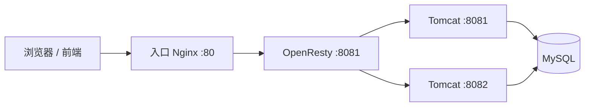

## 1. 本阶段要解决什么问题

前面的进程缓存由 Java 应用直接维护。为了进一步减少请求进入 Java 进程的次数，可以把缓存和请求编排前移到 Nginx：



本阶段先不接 Redis，只完成以下链路：

1. 前端访问 `/api/item/{id}`。
2. OpenResty 用 Lua 解析商品 ID。
3. Lua 分别请求 Tomcat 的商品接口和库存接口。
4. 将两个 JSON 结果拼成前端需要的响应。
5. 相同 URI 尽量落到相同 Tomcat 节点，提高该节点进程缓存的命中率。

## 2. OpenResty 是什么

OpenResty 是基于 Nginx 和 LuaJIT 的 Web 平台。它把 Lua 执行阶段嵌入 Nginx 的事件模型，因此可以在 Nginx 内完成鉴权、限流、缓存查询、请求聚合和路由等逻辑。

需要明确两点：

- Lua 代码运行在 Nginx worker 中，不应执行阻塞式 I/O。
- 同一个 worker 内，请求可能复用已加载的 Lua 模块；应避免使用可变全局变量保存请求状态。

## 3. 安装与目录

采用 CentOS 7 和 YUM 仓库安装，实际部署时应使用与你的操作系统和 OpenResty 版本匹配的官方安装方式。

课程中的核心命令如下：

```bash
yum install -y yum-utils
yum-config-manager --add-repo https://openresty.org/package/centos/openresty.repo
yum install -y openresty
yum install -y openresty-opm
```

常见目录：

```text
/usr/local/openresty/
├── nginx/
│   ├── conf/nginx.conf
│   ├── html/
│   └── logs/
└── lualib/
```

验证安装：

```bash
openresty -V
resty -V
```

配置修改后的安全检查顺序：

```bash
openresty -t
openresty -s reload
```

如果系统中的可执行文件叫 `nginx`，则使用：

```bash
nginx -t
nginx -s reload
```

不要跳过 `-t`。配置语法错误时直接 reload，可能导致新 worker 无法启动。

## 4. 配置 Lua 模块搜索路径

在 `nginx.conf` 的 `http` 块中配置：

```nginx
http {
    lua_package_path "/usr/local/openresty/lualib/?.lua;;";
    lua_package_cpath "/usr/local/openresty/lualib/?.so;;";

    # 其余配置……
}
```

说明：

- `lua_package_path`：查找 Lua 源码模块。
- `lua_package_cpath`：查找 Lua C 扩展模块。
- `?.lua` 中的 `?` 会被模块名替换。
- 末尾 `;;` 表示保留 Lua 原有的默认搜索路径。

课程文档曾出现 `/usr/loca/openresty/...`，正确路径是 `/usr/local/openresty/...`。

## 5. 第一个 OpenResty 接口

在 `server` 中配置：

```nginx
server {
    listen 8081;
    server_name _;

    location /api/item {
        default_type application/json;
        content_by_lua_file lua/item.lua;
    }
}
```

创建 `lua/item.lua`：

```lua
ngx.say('{"id":10001,"name":"示例商品"}')
```

访问：

```bash
curl -i http://localhost:8081/api/item
```

`content_by_lua_file` 表示响应内容由 Lua 文件生成。`ngx.say` 会输出内容并追加换行；若不希望追加换行，可使用 `ngx.print`。

## 6. 接收请求参数

### 6.1 路径参数

将 location 改为正则匹配：

```nginx
location ~ ^/api/item/(\d+)$ {
    default_type application/json;
    content_by_lua_file lua/item.lua;
}
```

Lua 中读取第一个捕获组：

```lua
local id = ngx.var[1]
ngx.say("商品 ID：", id)
```

`ngx.var[1]` 得到的是字符串。如果要参与数值运算，应显式转换：

```lua
local id = tonumber(ngx.var[1])
if not id then
    ngx.status = ngx.HTTP_BAD_REQUEST
    ngx.say('{"message":"非法商品 ID"}')
    return
end
```

### 6.2 常见参数 API

| 参数位置 | Lua API | 说明 |
|---|---|---|
| 正则路径捕获 | `ngx.var[1]` | 对应 location 正则中的第一个括号 |
| 请求头 | `ngx.req.get_headers()` | 返回 table |
| GET 查询参数 | `ngx.req.get_uri_args()` | 例如 `?page=1` |
| POST 表单 | `ngx.req.read_body()` + `ngx.req.get_post_args()` | 先读取请求体 |
| 原始请求体 | `ngx.req.read_body()` + `ngx.req.get_body_data()` | 可用于 JSON |

示例：

```lua
local headers = ngx.req.get_headers()
local args = ngx.req.get_uri_args()

ngx.log(ngx.INFO, "user-agent=", headers["user-agent"] or "")
ngx.log(ngx.INFO, "page=", args.page or "1")
```

读取 JSON 请求体：

```lua
local cjson = require("cjson.safe")

ngx.req.read_body()
local body = ngx.req.get_body_data()
local data, err = cjson.decode(body or "")

if not data then
    ngx.status = ngx.HTTP_BAD_REQUEST
    ngx.say(cjson.encode({ message = "JSON 格式错误", detail = err }))
    return
end
```

`cjson.safe` 在解析失败时返回 `nil, err`，比直接抛异常更适合接口代码。

## 7. OpenResty 发起内部子请求

### 7.1 为什么使用内部 location

OpenResty 可以通过 `ngx.location.capture` 发起 Nginx 内部子请求：

```nginx
location /item {
    proxy_pass http://item-service;
}
```

Lua：

```lua
local resp = ngx.location.capture("/item", {
    method = ngx.HTTP_GET,
    args = { id = 10001 }
})
```

响应对象常用字段：

| 字段 | 含义 |
|---|---|
| `resp.status` | HTTP 状态码 |
| `resp.header` | 响应头 |
| `resp.body` | 响应体字符串 |
| `resp.truncated` | 响应体是否被截断 |

内部子请求不是浏览器重定向，客户端看不到这个过程。

### 7.2 封装通用 HTTP 函数

创建 `/usr/local/openresty/lualib/common.lua`：

```lua
local _M = {}

function _M.read_http(path, params)
    local resp = ngx.location.capture(path, {
        method = ngx.HTTP_GET,
        args = params
    })

    if not resp then
        return nil, "subrequest failed: no response"
    end

    if resp.status < 200 or resp.status >= 300 then
        return nil, "subrequest status: " .. tostring(resp.status)
    end

    if resp.truncated then
        return nil, "subrequest body was truncated"
    end

    return resp.body, nil
end

return _M
```

调用：

```lua
local common = require("common")
local body, err = common.read_http("/item", { id = 10001 })
```

## 8. 配置 Tomcat 集群

假设两个 Java 实例分别监听 8081 和 8082：

```nginx
upstream item-service {
    hash $request_uri consistent;

    server 192.168.150.101:8081;
    server 192.168.150.101:8082;
}

server {
    listen 8081;

    location /item {
        proxy_pass http://item-service;
    }

    location /item/stock {
        proxy_pass http://item-service;
    }
}
```

使用：

```nginx
hash $request_uri;
```

它可以让相同 URI 通常落到相同节点，有助于命中该 JVM 的 Caffeine 进程缓存。这里补充 `consistent`，因为节点增减时，一致性哈希通常只重新映射少部分 key，而普通哈希可能让大量 key 改变节点。

### 8.1 为什么用 `$request_uri`

若商品接口为：

```text
/item/10001
/item/stock/10001
```

两个 URI 不同，可能被分配到不同节点。如果 Java 接口使用查询参数并通过统一路径代理：

```text
/item?id=10001
/item/stock?id=10001
```

仍然是两个不同 URI。对于当前案例，只要各接口自己的同类请求保持稳定即可；商品和库存不要求落到同一节点，因为它们有各自的缓存。

如果业务确实要求“同一商品的不同接口落在同一节点”，应从 URI 中提取商品 ID，使用统一的哈希 key，而不是机械地使用完整 `$request_uri`。

## 9. JSON 编解码

### 9.1 编码

```lua
local cjson = require("cjson.safe")

local json, err = cjson.encode({
    id = 10001,
    name = "手机",
    stock = 100
})

if not json then
    ngx.log(ngx.ERR, "encode failed: ", err)
end
```

### 9.2 解码

```lua
local data, err = cjson.decode('{"id":10001,"stock":100}')
if not data then
    ngx.log(ngx.ERR, "decode failed: ", err)
    return
end

ngx.say(data.id)
```

JSON 对象会转成 Lua table；JSON 数组也会转成 table。不要依赖 Lua table 的键遍历顺序。

## 10. 完整的商品聚合接口

### 10.1 Nginx 配置

```nginx
upstream item-service {
    hash $request_uri consistent;
    server 192.168.150.101:8081;
    server 192.168.150.101:8082;
}

server {
    listen 8081;
    server_name _;

    location ~ ^/api/item/(\d+)$ {
        default_type application/json;
        content_by_lua_file lua/item.lua;
    }

    location /item {
        internal;
        proxy_pass http://item-service;
    }

    location /item/stock {
        internal;
        proxy_pass http://item-service;
    }
}
```

`internal` 表示 location 只允许 Nginx 内部请求，外部直接访问会返回 404，避免绕过 API 层。

### 10.2 `item.lua`

```lua
local cjson = require("cjson.safe")
local common = require("common")

local id = tonumber(ngx.var[1])
if not id then
    ngx.status = ngx.HTTP_BAD_REQUEST
    ngx.say(cjson.encode({ message = "非法商品 ID" }))
    return
end

local item_json, item_err = common.read_http("/item", { id = id })
if not item_json then
    ngx.log(ngx.ERR, "read item failed: ", item_err)
    ngx.status = ngx.HTTP_BAD_GATEWAY
    ngx.say(cjson.encode({ message = "商品服务暂时不可用" }))
    return
end

local stock_json, stock_err = common.read_http("/item/stock", { id = id })
if not stock_json then
    ngx.log(ngx.ERR, "read stock failed: ", stock_err)
    ngx.status = ngx.HTTP_BAD_GATEWAY
    ngx.say(cjson.encode({ message = "库存服务暂时不可用" }))
    return
end

local item, decode_item_err = cjson.decode(item_json)
local stock, decode_stock_err = cjson.decode(stock_json)

if not item or not stock then
    ngx.log(
        ngx.ERR,
        "decode failed, item_err=", decode_item_err or "",
        ", stock_err=", decode_stock_err or ""
    )
    ngx.status = ngx.HTTP_BAD_GATEWAY
    ngx.say(cjson.encode({ message = "上游响应格式错误" }))
    return
end

item.stock = stock.stock
item.sold = stock.sold

local result, encode_err = cjson.encode(item)
if not result then
    ngx.log(ngx.ERR, "encode result failed: ", encode_err)
    ngx.status = ngx.HTTP_INTERNAL_SERVER_ERROR
    ngx.say('{"message":"响应生成失败"}')
    return
end

ngx.say(result)
```

## 11. 并行请求的补充

上面的两个 `ngx.location.capture` 是顺序执行。商品和库存互不依赖时，可使用 `ngx.location.capture_multi` 并行发起：

```lua
local responses = {
    { "/item", { args = { id = id } } },
    { "/item/stock", { args = { id = id } } }
}

local item_resp, stock_resp = ngx.location.capture_multi(responses)
```

这能减少聚合接口的总等待时间，但代码必须分别检查两个响应的状态、截断标记和 JSON 格式。入门阶段先掌握通用错误处理，再引入并行化。

## 12. 从浏览器到 Tomcat 的完整请求路径

前端页面请求：

```javascript
axios.get("/api/item/" + id)
```

外层 Nginx：

```nginx
upstream nginx-cluster {
    server 192.168.150.101:8081;
}

server {
    listen 80;

    location /api {
        proxy_pass http://nginx-cluster;
    }

    location / {
        root html;
        index index.html;
    }
}
```

完整链路：

```text
浏览器
  → 入口 Nginx:80
  → OpenResty:8081 的 /api/item/{id}
  → Lua 内部请求 /item 与 /item/stock
  → Tomcat 集群
  → Caffeine / MySQL
  → Lua 聚合 JSON
  → 浏览器
```

## 13. 验证步骤

### 13.1 先验证 Java 接口

```bash
curl -i "http://192.168.150.101:8081/item?id=10001"
curl -i "http://192.168.150.101:8081/item/stock?id=10001"
```

### 13.2 再验证 OpenResty 内部链路

```bash
curl -i "http://192.168.150.101:8081/api/item/10001"
```

### 13.3 最后验证入口 Nginx

```bash
curl -i "http://192.168.150.101/api/item/10001"
```

### 13.4 查看日志

```bash
tail -f /usr/local/openresty/nginx/logs/error.log
tail -f /usr/local/openresty/nginx/logs/access.log
```

生产环境不要长期保留大量 `ngx.ERR` 以下的调试日志，否则会增加 I/O 和磁盘压力。

## 14. 常见故障

| 现象 | 优先检查 |
|---|---|
| OpenResty 启动失败 | `openresty -t`、配置块位置、分号 |
| `module 'common' not found` | `lua_package_path`、文件路径和文件名 |
| 访问 `/api/item/1` 返回 404 | location 正则、入口 Nginx 的代理路径 |
| 子请求 404 | 内部 location 是否存在、URI 是否一致 |
| 子请求 502 | Tomcat 地址、端口、服务健康状态 |
| JSON 解码失败 | 上游是否返回 HTML 错误页、空字符串或非 JSON |
| 请求总落到同一节点 | upstream 节点是否都可用、哈希 key 是否缺乏离散度 |
| 修改 Lua 后未生效 | 是否 reload、编辑的是否为当前实例配置目录 |

## 15. 本章需要记住的边界

1. `ngx.location.capture` 是 Nginx 内部子请求，不等同于普通阻塞式 HTTP 客户端。
2. 每个外部输入都要校验；每个上游响应都要检查状态和格式。
3. 请求级变量必须是 `local`，不要用 Lua 全局变量承载请求状态。
4. 哈希负载均衡只是提高进程缓存亲和性，不保证某个节点永远不变。
5. 到这里仍然会访问 Tomcat。下一章加入 Redis 和 Nginx shared dict 后，才形成真正的多级缓存查询链。
