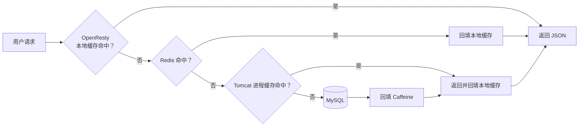

> 本文在 OpenResty 调用 Tomcat 的基础上加入 Redis 和 Nginx shared dict，形成“本地缓存 → Redis → Tomcat → MySQL”的完整查询链。

## 1. 最终查询链



各层定位：

| 层级 | 技术 | 共享范围 | 速度 | 主要作用 |
|---|---|---|---|---|
| L1 | Nginx shared dict | 单个 OpenResty 实例的所有 worker | 极快 | 扛热点请求 |
| L2 | Redis | 多个应用和 OpenResty 实例 | 快 | 跨实例共享缓存 |
| L3 | Caffeine | 单个 JVM | 极快 | 保护 Java 服务 |
| 数据源 | MySQL | 全局 | 相对慢 | 权威数据 |

“本地”不等于“单个 worker”：`lua_shared_dict` 在同一 Nginx 实例的 worker 间共享，但不同机器、不同 OpenResty 实例之间不共享。

## 2. 缓存预热

### 2.1 为什么需要预热

新 Redis 刚启动时没有数据。如果大批请求同时到达，所有请求都会穿透到 Tomcat 和数据库，形成冷启动压力。预热是在流量到来前把预期热点数据写入 Redis。

在 Spring 容器启动完成后读取全部商品与库存：

```java
@Component
public class RedisHandler implements InitializingBean {

    private final StringRedisTemplate redisTemplate;
    private final IItemService itemService;
    private final IItemStockService stockService;

    public RedisHandler(
            StringRedisTemplate redisTemplate,
            IItemService itemService,
            IItemStockService stockService) {
        this.redisTemplate = redisTemplate;
        this.itemService = itemService;
        this.stockService = stockService;
    }

    @Override
    public void afterPropertiesSet() {
        List<Item> items = itemService.list();
        List<ItemStock> stocks = stockService.list();

        for (Item item : items) {
            redisTemplate.opsForValue().set(
                    "item:id:" + item.getId(),
                    JSON.toJSONString(item)
            );
        }

        for (ItemStock stock : stocks) {
            redisTemplate.opsForValue().set(
                    "item:stock:id:" + stock.getId(),
                    JSON.toJSONString(stock)
            );
        }
    }
}
```

这是适合学习的小数据量写法。生产环境要额外考虑：

- 不应让每个应用副本启动时都全表扫描。
- 只预热热点数据，并分批读取、批量写入。
- 预热失败不能悄悄忽略，应有重试、告警和降级策略。
- 预热过程应幂等。
- 大数据量场景可由独立任务执行，不阻塞应用就绪。
- 课程代码写入 Redis 时没有 TTL，必须配合同步、淘汰和容量治理。

### 2.2 Redis 键设计

| 数据 | Key | Value |
|---|---|---|
| 商品 | `item:id:{id}` | 商品 JSON |
| 库存 | `item:stock:id:{id}` | 库存 JSON |

示例：

```text
item:id:10001
item:stock:id:10001
```

建议：

1. key 使用明确的业务命名空间。
2. 不要把展示名称等可变字段作为 key。
3. value 结构变化时考虑版本，例如 `item:v2:id:10001`。
4. 分布式缓存的 key 规则必须由生产者和消费者共同约定。

## 3. Java 连接 Redis

课程依赖：

```xml
<dependency>
    <groupId>org.springframework.boot</groupId>
    <artifactId>spring-boot-starter-data-redis</artifactId>
</dependency>
```

配置：

```yaml
spring:
  redis:
    host: 192.168.150.101
    port: 6379
```

课程通过 Docker 启动 Redis：

```bash
docker run --name redis \
  -p 6379:6379 \
  -d redis redis-server --appendonly yes
```

生产环境至少还要配置认证、持久化、内存上限、淘汰策略、主从或集群，以及网络访问控制。

## 4. OpenResty 查询 Redis

OpenResty 常用 `lua-resty-redis`。最重要的并发规则是：Redis 对象必须在请求函数内部创建，不能放在 Lua 模块顶层共享。

创建 `/usr/local/openresty/lualib/common.lua`：

```lua
local redis = require("resty.redis")

local _M = {}

function _M.read_redis(host, port, key)
    -- 每次请求创建自己的 redis 对象
    local red, new_err = redis:new()
    if not red then
        return nil, "create redis client failed: " .. tostring(new_err)
    end

    -- 连接、发送、读取超时，单位毫秒
    red:set_timeouts(1000, 1000, 1000)

    local ok, connect_err = red:connect(host, port)
    if not ok then
        return nil, "connect redis failed: " .. tostring(connect_err)
    end

    local value, get_err = red:get(key)
    if not value then
        red:close()
        return nil, "redis get failed: " .. tostring(get_err)
    end

    -- 命令执行完后把连接放回当前 worker 的连接池
    local keepalive_ok, keepalive_err = red:set_keepalive(10000, 100)
    if not keepalive_ok then
        ngx.log(ngx.WARN, "redis keepalive failed: ", keepalive_err)
    end

    -- Redis key 不存在时返回 ngx.null，而不是 Lua nil
    if value == ngx.null then
        return nil, nil
    end

    return value, nil
end

return _M
```

### 4.1 为什么不能把 `red` 放在模块顶层

下面的写法有并发安全风险：

```lua
local redis = require("resty.redis")
local red = redis:new()

function read_redis(...)
    -- 多个请求可能共享同一个对象
end
```

OpenResty worker 会在请求间复用已加载模块。模块级 `red` 可能被并发请求共同使用，造成响应串线或 “socket busy” 一类问题。

### 4.2 连接池要点

- `set_keepalive(10000, 100)`：空闲超时 10 秒，池大小上限 100。
- 连接池是每个 Nginx worker 独立的。
- 调用 `set_keepalive` 后，当前 Redis 对象的连接已交回池中，不应继续用它执行命令。
- 业务代码需要为连接、发送和读取分别设置合理超时。
- Redis 命令失败时不要把错误结果写入本地缓存。

## 5. 查询 Tomcat 的通用函数

把上一章的 HTTP 函数放进同一个模块：

```lua
function _M.read_http(path, params)
    local resp = ngx.location.capture(path, {
        method = ngx.HTTP_GET,
        args = params
    })

    if not resp then
        return nil, "subrequest failed: no response"
    end

    if resp.status < 200 or resp.status >= 300 then
        return nil, "subrequest status: " .. tostring(resp.status)
    end

    if resp.truncated then
        return nil, "subrequest body was truncated"
    end

    return resp.body, nil
end
```

## 6. Nginx 本地缓存

### 6.1 配置共享内存

在 `http` 块中声明：

```nginx
http {
    lua_shared_dict item_cache 150m;

    # 其余配置……
}
```

在 Lua 中取得字典：

```lua
local item_cache = ngx.shared.item_cache
```

读写：

```lua
local value = item_cache:get(key)

local ok, err = item_cache:set(key, value, 1800)
if not ok then
    ngx.log(ngx.WARN, "local cache set failed: ", err)
end
```

`set` 的第三个参数是过期时间，单位为秒。

### 6.2 容量与淘汰

shared dict 的容量固定。如果空间不足，写入可能失败或触发淘汰。必须检查 `set` 返回值，并监控：

- 当前容量和空闲空间。
- 写入失败次数。
- 命中率。
- 淘汰量。
- 单条 value 大小。

不要把无限增长、无 TTL 的数据写进 shared dict。

## 7. 封装三级读取逻辑

把以下函数继续放入 `common.lua`：

```lua
function _M.read_data(key, expire, path, params)
    local item_cache = ngx.shared.item_cache

    -- L1：OpenResty 本地缓存
    local local_value = item_cache:get(key)
    if local_value then
        return local_value, "local", nil
    end

    -- L2：Redis
    local redis_value, redis_err =
        _M.read_redis("192.168.150.101", 6379, key)

    if redis_value then
        local ok, set_err = item_cache:set(key, redis_value, expire)
        if not ok then
            ngx.log(ngx.WARN, "local cache set failed: ", set_err)
        end
        return redis_value, "redis", nil
    end

    if redis_err then
        ngx.log(ngx.WARN, "redis unavailable, fallback to http: ", redis_err)
    end

    -- L3：Tomcat，Tomcat 内部还有 Caffeine 和 MySQL
    local http_value, http_err = _M.read_http(path, params)
    if not http_value then
        return nil, nil, http_err
    end

    local ok, set_err = item_cache:set(key, http_value, expire)
    if not ok then
        ngx.log(ngx.WARN, "local cache set failed: ", set_err)
    end

    return http_value, "tomcat", nil
end
```

关键点：

- 函数使用 `local` 或模块字段 `_M.read_data`，不创建全局函数。
- Redis 未命中和 Redis 故障都可降级到 Tomcat，但日志和指标必须区分。
- 只有取得有效响应后才写入本地缓存。
- `item_cache:set(key, nil, expire)` 是错误用法；缓存前必须判断值存在。
- 课程链路在 Tomcat 回源后只回填 Nginx 本地缓存，不由 Lua 回填 Redis。Redis 主要依赖预热和 Canal 同步来维护。

## 8. 完整的 `common.lua`

```lua
local redis = require("resty.redis")

local _M = {}

function _M.read_redis(host, port, key)
    local red, new_err = redis:new()
    if not red then
        return nil, "create redis client failed: " .. tostring(new_err)
    end

    red:set_timeouts(1000, 1000, 1000)

    local ok, connect_err = red:connect(host, port)
    if not ok then
        return nil, "connect redis failed: " .. tostring(connect_err)
    end

    local value, get_err = red:get(key)
    if not value then
        red:close()
        return nil, "redis get failed: " .. tostring(get_err)
    end

    local keepalive_ok, keepalive_err = red:set_keepalive(10000, 100)
    if not keepalive_ok then
        ngx.log(ngx.WARN, "redis keepalive failed: ", keepalive_err)
    end

    if value == ngx.null then
        return nil, nil
    end

    return value, nil
end

function _M.read_http(path, params)
    local resp = ngx.location.capture(path, {
        method = ngx.HTTP_GET,
        args = params
    })

    if not resp then
        return nil, "subrequest failed: no response"
    end

    if resp.status < 200 or resp.status >= 300 then
        return nil, "subrequest status: " .. tostring(resp.status)
    end

    if resp.truncated then
        return nil, "subrequest body was truncated"
    end

    return resp.body, nil
end

function _M.read_data(key, expire, path, params)
    local item_cache = ngx.shared.item_cache

    local value = item_cache:get(key)
    if value then
        return value, "local", nil
    end

    local redis_err
    value, redis_err = _M.read_redis("192.168.150.101", 6379, key)
    if value then
        local ok, set_err = item_cache:set(key, value, expire)
        if not ok then
            ngx.log(ngx.WARN, "local cache set failed: ", set_err)
        end
        return value, "redis", nil
    end

    if redis_err then
        ngx.log(ngx.WARN, "redis fallback: ", redis_err)
    end

    local http_err
    value, http_err = _M.read_http(path, params)
    if not value then
        return nil, nil, http_err
    end

    local ok, set_err = item_cache:set(key, value, expire)
    if not ok then
        ngx.log(ngx.WARN, "local cache set failed: ", set_err)
    end

    return value, "tomcat", nil
end

return _M
```

## 9. 完整的 `item.lua`

商品缓存 30 分钟，库存缓存 1 分钟：

```lua
local cjson = require("cjson.safe")
local common = require("common")

local id = tonumber(ngx.var[1])
if not id then
    ngx.status = ngx.HTTP_BAD_REQUEST
    ngx.say(cjson.encode({ message = "非法商品 ID" }))
    return
end

local item_key = "item:id:" .. id
local stock_key = "item:stock:id:" .. id

local item_json, item_source, item_err =
    common.read_data(item_key, 1800, "/item", { id = id })

if not item_json then
    ngx.log(ngx.ERR, "read item failed: ", item_err or "unknown")
    ngx.status = ngx.HTTP_BAD_GATEWAY
    ngx.say(cjson.encode({ message = "商品服务暂时不可用" }))
    return
end

local stock_json, stock_source, stock_err =
    common.read_data(stock_key, 60, "/item/stock", { id = id })

if not stock_json then
    ngx.log(ngx.ERR, "read stock failed: ", stock_err or "unknown")
    ngx.status = ngx.HTTP_BAD_GATEWAY
    ngx.say(cjson.encode({ message = "库存服务暂时不可用" }))
    return
end

local item, item_decode_err = cjson.decode(item_json)
local stock, stock_decode_err = cjson.decode(stock_json)

if not item or not stock then
    ngx.log(
        ngx.ERR,
        "decode cache value failed, item=", item_decode_err or "",
        ", stock=", stock_decode_err or ""
    )
    ngx.status = ngx.HTTP_BAD_GATEWAY
    ngx.say(cjson.encode({ message = "缓存数据格式错误" }))
    return
end

item.stock = stock.stock
item.sold = stock.sold

local result, encode_err = cjson.encode(item)
if not result then
    ngx.log(ngx.ERR, "encode result failed: ", encode_err)
    ngx.status = ngx.HTTP_INTERNAL_SERVER_ERROR
    ngx.say('{"message":"响应生成失败"}')
    return
end

-- 便于学习环境观察命中层级；生产环境可改为内部日志或指标
ngx.header["X-Item-Cache"] = item_source
ngx.header["X-Stock-Cache"] = stock_source
ngx.say(result)
```

## 10. 为什么商品和库存 TTL 不同

课程设置：

| 数据 | 本地缓存 TTL | 原因 |
|---|---:|---|
| 商品信息 | 1800 秒 | 名称、图片等相对稳定 |
| 库存 | 60 秒 | 变化更频繁，对时效性更敏感 |

TTL 是一致性与性能的折中，不是固定答案。应根据：

- 数据更新频率。
- 用户能容忍的陈旧时间。
- 回源成本。
- 主动失效机制是否可靠。
- 热点程度。

来确定。实际可加入小幅随机抖动，避免大量 key 同一时刻过期。

## 11. 各种故障下会发生什么

| 场景 | 行为 | 风险 |
|---|---|---|
| 本地缓存命中 | 直接返回 | 可能短暂读到旧值 |
| 本地未命中、Redis 命中 | 回填本地后返回 | 正常 |
| Redis key 不存在 | 回源 Tomcat | 热点空 key 可能穿透 |
| Redis 超时 | 降级到 Tomcat | 大面积故障时可能压垮应用 |
| Tomcat 失败 | 返回 502 | 应结合重试边界和熔断 |
| MySQL 慢 | Caffeine 未命中时受影响 | 可能逐层放大 |
| shared dict 满 | 本地写入失败但仍可返回 | 命中率下降 |

“能降级”不代表可以无限回源。Redis 故障时需要限流、熔断、请求合并和容量预案。

## 12. 三类经典缓存问题

### 12.1 缓存穿透

请求的数据在 Redis 和数据库中都不存在。

可选措施：

- 参数和 ID 合法性校验。
- 对不存在的数据短时间缓存空值。
- 布隆过滤器。
- 限制异常请求来源。

缓存空值时应使用特殊标记，不要把 Lua `nil` 当作 value：

```text
__NULL__
```

并设置较短 TTL。

### 12.2 缓存击穿

单个热点 key 过期，大量请求同时回源。

可选措施：

- 请求合并或互斥锁。
- 热点 key 逻辑过期。
- 主动刷新。
- 允许短时间返回旧值。

OpenResty 可借助锁库实现请求合并，但锁必须有超时，持锁范围只包含回源和回填。

### 12.3 缓存雪崩

大量 key 同时失效或 Redis 整体不可用。

可选措施：

- TTL 加随机值。
- Redis 高可用和容量治理。
- 分批预热。
- 限流、熔断、降级。
- 多级缓存保留合理的过期差异。

## 13. 观测指标

不要只看总接口耗时，应分别记录：

- L1、Redis、Tomcat 命中次数和命中率。
- Redis 连接失败、超时、命令错误。
- Tomcat 子请求状态码和耗时。
- shared dict 写入失败和容量。
- 各 key 类型的 value 大小。
- 回源 MySQL 的 QPS。
- 缓存数据年龄和同步延迟。

学习环境可以临时用响应头观察命中层，生产环境更适合用日志、指标系统和追踪系统。

## 14. 验证方法

第一次请求：

```bash
curl -i "http://192.168.150.101/api/item/10001"
```

预期：

```text
X-Item-Cache: redis
X-Stock-Cache: redis
```

再次请求：

```bash
curl -i "http://192.168.150.101/api/item/10001"
```

预期：

```text
X-Item-Cache: local
X-Stock-Cache: local
```

检查 Redis：

```bash
redis-cli GET item:id:10001
redis-cli GET item:stock:id:10001
```

验证回源时，应只删除明确的测试 key：

```bash
redis-cli DEL item:id:10001 item:stock:id:10001
```

随后 reload OpenResty 或等待本地缓存过期，再发起请求。不要在共享环境中使用 `FLUSHALL`。

## 15. 与下一章的关系

到这里读取速度已经提升，但数据更新后会出现多个副本：

```text
MySQL
Redis
OpenResty shared dict
每个 JVM 的 Caffeine
```

如果只更新 MySQL，其余缓存仍可能返回旧值。因此下一章要解决缓存同步，以及仍未完全覆盖的 OpenResty 本地缓存失效问题。
