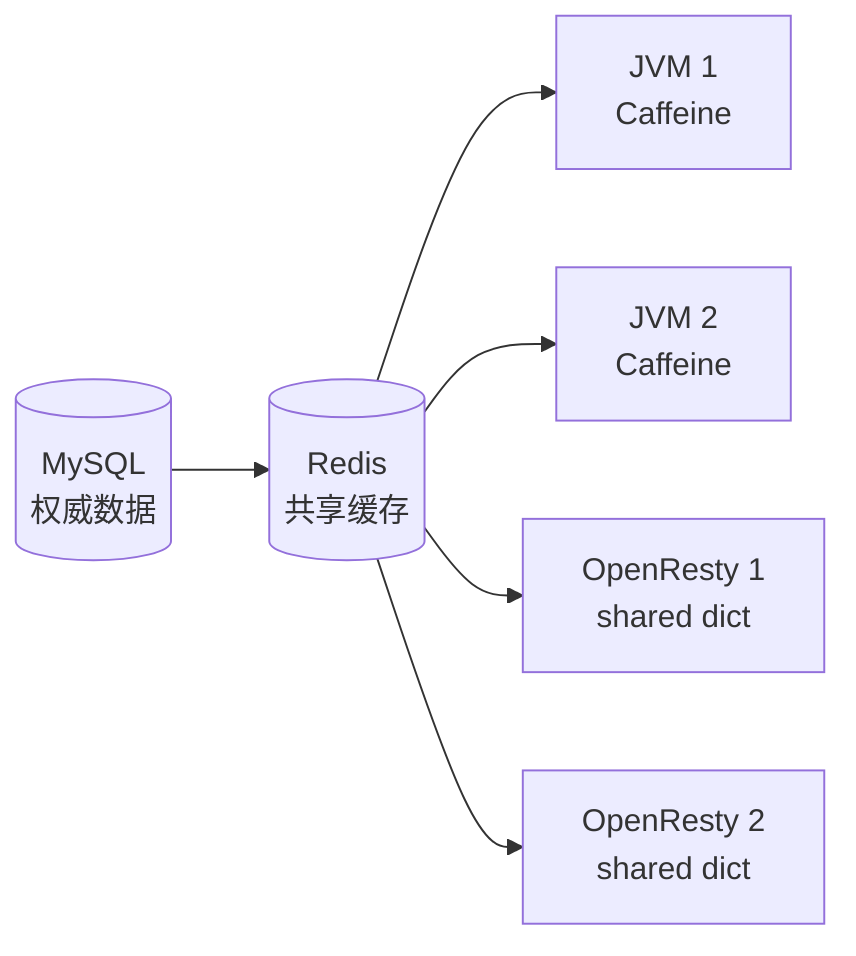
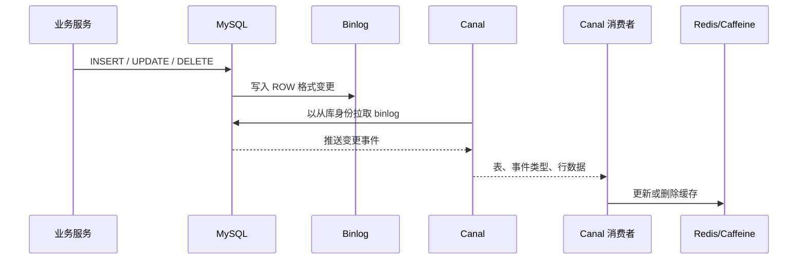
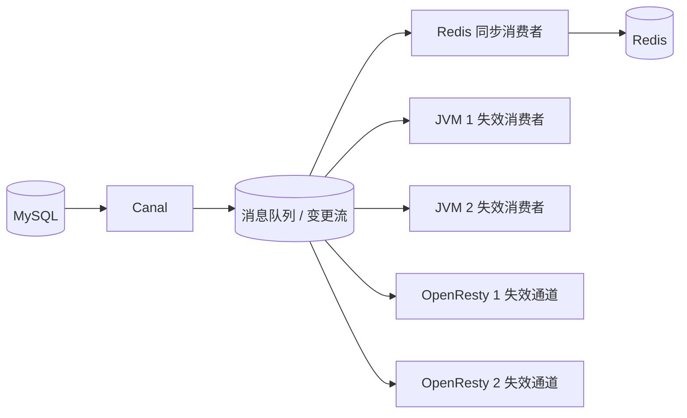

> 本章说明 MySQL 数据变化后，如何让 Redis、Caffeine 和 OpenResty 本地缓存尽快收敛。

## 1. 为什么需要缓存同步

多级缓存把同一份业务数据复制到了多个位置：



如果后台只修改 MySQL，那么缓存仍然可能返回修改前的数据。缓存同步要解决的是：

1. 哪个数据源是权威来源。
2. 数据变化由谁发现。
3. 哪些缓存需要更新或删除。
4. 同步失败如何重试和补偿。
5. 最长允许不一致多久。

绝大多数缓存方案提供的是“最终一致性”，不是数据库与多个缓存之间的原子强一致性。

## 2. 常见同步策略

### 2.1 依赖 TTL 自然过期

写请求只更新数据库，等待缓存自己过期。

优点：

- 实现简单。
- 写链路没有额外依赖。
- 缓存系统故障不影响数据库提交。

缺点：

- 在 TTL 内必然可能读到旧数据。
- TTL 越短，回源越频繁。
- 长 TTL 的热点数据可能长时间陈旧。

适合变化少、允许一定延迟的数据。即便采用主动同步，也建议保留 TTL 作为兜底。

### 2.2 同步双写

业务服务在同一个请求中更新数据库和缓存。

```text
请求 → 更新数据库 → 更新/删除缓存 → 返回
```

优点：

- 更新延迟低。
- 逻辑直观。

缺点：

- 数据库和 Redis 通常不在同一个本地事务中，任一步失败都可能不一致。
- 写请求延迟增加。
- 所有写入口都必须遵守同一规则。
- 重试可能造成乱序覆盖。

更常见的做法是“更新数据库后删除缓存”，让后续读请求回填，而不是直接写入缓存。删除通常比更新更不容易把旧对象写回去，但仍需处理失败重试和并发时序。

### 2.3 异步消息

业务提交数据库事务后发送变更消息，消费者更新或删除缓存。

优点：

- 写链路与缓存处理解耦。
- 可以多消费者广播到不同缓存。
- 适合重试、削峰和审计。

缺点：

- 需要消息可靠投递。
- 要处理重复、乱序、积压和死信。
- 业务代码或事务基础设施需要可靠地产生消息。

如果“提交数据库”和“发送消息”分两步完成，仍可能出现数据库成功但消息丢失。生产系统可采用事务消息或 Outbox 模式。

### 2.4 订阅数据库变更日志

业务只写数据库，Canal 订阅 MySQL binlog，再把变更分发给缓存同步程序。

优点：

- 对原有写业务侵入较小。
- 不容易漏掉某个业务入口。
- 可统一消费数据变化。

缺点：

- 同步是异步的，存在延迟窗口。
- Canal、网络或消费者故障会造成积压。
- 要处理重复事件、断点恢复和数据重建。
- 只能看到数据库最终产生的变更，无法自动理解所有业务语义。

## 3. 策略对比

| 策略 | 一致性 | 业务侵入 | 复杂度 | 主要风险 |
|---|---|---:|---:|---|
| TTL 自然过期 | 最终一致，延迟约等于 TTL | 低 | 低 | 长时间旧值 |
| 同步双写 | 延迟低，但不是天然原子 | 高 | 中 | 部分成功、写延迟 |
| 异步 MQ | 最终一致 | 中 | 高 | 丢失、重复、乱序 |
| Canal 订阅 binlog | 最终一致 | 低 | 中到高 | 延迟、积压、映射错误 |

课程把同步双写概括为“强一致性”并不严谨。若没有分布式事务、版本控制或读写屏障，数据库和缓存仍可能部分成功。

## 4. Canal 工作原理

Canal 模拟 MySQL 从库的复制协议：



关键认识：

- Canal 监听的是数据库已经写入 binlog 的结果。
- 一个数据库事务可能产生多条行事件。
- 消费者收到事件到完成缓存更新之间存在延迟。
- 事件可能重复投递，处理逻辑必须幂等。

## 5. MySQL 开启 binlog

环境使用 Docker MySQL，配置文件核心内容可整理为：

```ini
[mysqld]
skip-name-resolve
character_set_server=utf8
datadir=/var/lib/mysql

server-id=1000
log-bin=/var/lib/mysql/mysql-bin
binlog-format=ROW
binlog-do-db=heima
```

说明：

- `server-id`：复制拓扑中必须唯一。
- `log-bin`：启用 binlog。
- `binlog-format=ROW`：记录行变更，Canal 才能可靠还原前后数据。课程本地安装笔记遗漏了这一项，这里已补齐。
- `binlog-do-db=heima`：只记录指定库，学习环境可用；复杂跨库语句和生产拓扑中应谨慎评估。

修改配置后重启 MySQL，并验证：

```sql
SHOW VARIABLES LIKE 'log_bin';
SHOW VARIABLES LIKE 'binlog_format';
SHOW VARIABLES LIKE 'server_id';
SHOW MASTER STATUS;
```

预期：

```text
log_bin       ON
binlog_format ROW
```

MySQL 不同大版本的命令和默认值可能有差异，应以实际版本文档为准。

## 6. 创建 Canal 复制账号

使用专用账号：

```sql
CREATE USER 'canal'@'%' IDENTIFIED BY 'canal';

GRANT SELECT, REPLICATION SLAVE, REPLICATION CLIENT
ON *.* TO 'canal'@'%';

FLUSH PRIVILEGES;
```

遵循最小权限原则，通常只授予 Canal 读取 binlog 和查询元数据所需权限。课程安装文档还授予了 `SUPER`，现代环境不应默认扩大权限，除非你所用版本和部署方式明确要求。

验证：

```sql
SHOW GRANTS FOR 'canal'@'%';
```

生产环境还应限制来源地址、使用强密码，并通过 Secret 管理凭据。

## 7. 启动 Canal Server

使用的是 `canal/canal-server:v1.1.5`，这是为了复现原案例的旧版本环境，不代表当前生产推荐版本。

### 7.1 Docker 网络

让 Canal 通过容器名访问 MySQL：

```bash
docker network create heima
docker network connect heima mysql
```

如果网络已存在，无需重复创建。

### 7.2 镜像导入

资料提供 `canal.tar` 时：

```bash
docker load -i canal.tar
```

检查：

```bash
docker images
```

### 7.3 启动命令

```bash
docker run -p 11111:11111 \
  --name canal \
  -e canal.destinations=heima \
  -e canal.instance.master.address=mysql:3306 \
  -e canal.instance.dbUsername=canal \
  -e canal.instance.dbPassword=canal \
  -e canal.instance.connectionCharset=UTF-8 \
  -e canal.instance.tsdb.enable=true \
  -e canal.instance.gtidon=false \
  -e 'canal.instance.filter.regex=heima\..*' \
  --network heima \
  -d canal/canal-server:v1.1.5
```

参数说明：

| 参数 | 含义 |
|---|---|
| `canal.destinations` | 实例/目标名称，客户端配置必须一致 |
| `master.address` | MySQL 地址 |
| `dbUsername` / `dbPassword` | 复制账号 |
| `filter.regex` | 订阅表的正则 |
| `gtidon` | 是否使用 GTID |
| `tsdb.enable` | 是否记录表结构历史，具体行为取决于版本 |

Shell 对反斜杠的处理容易造成过滤正则失效，因此建议把整个环境变量参数放在单引号中。若通过 Compose 或配置文件部署，应按对应格式转义。

### 7.4 检查启动状态

```bash
docker ps --filter name=canal
docker logs --tail 200 canal
```

重点关注：

- 能否连接 MySQL。
- 用户是否有复制权限。
- destination 是否创建成功。
- binlog 文件和 position 是否有效。
- 表过滤规则是否匹配 `heima.tb_item`。

## 8. Java 客户端接入

使用：

```xml
<dependency>
    <groupId>top.javatool</groupId>
    <artifactId>canal-spring-boot-starter</artifactId>
    <version>1.2.1-RELEASE</version>
</dependency>
```

配置：

```yaml
canal:
  destination: heima
  server: 192.168.150.101:11111
```

这与 Spring Boot 2.3.9、Java 8 项目配套。新项目采用该第三方 starter 前，应核对其维护状态、兼容的 Canal 协议和 Spring Boot 版本。

## 9. 实体映射

 `Item` 实体同时用于 ORM 和 Canal 行数据映射：

```java
@Data
@TableName("tb_item")
public class Item {

    @Id
    @TableId(type = IdType.AUTO)
    private Long id;

    @Column(name = "name")
    private String name;

    @Column(name = "title")
    private String title;

    @Column(name = "price")
    private Long price;

    @Column(name = "image")
    private String image;

    @Column(name = "category")
    private String category;

    @Column(name = "brand")
    private String brand;

    @Column(name = "spec")
    private String spec;

    @Column(name = "status")
    private Integer status;

    @Column(name = "create_time")
    private LocalDateTime createTime;

    @Column(name = "update_time")
    private LocalDateTime updateTime;
}
```

常见映射要求：

- 表字段名与 Java 字段对应。
- 下划线字段显式用 `@Column` 标注更清晰。
- 主键用 `@Id` 标记。
- 日期、数值和空值类型要与数据库兼容。

如果表结构变化但实体未同步更新，消费者可能解析失败，因此数据库变更也要纳入版本发布流程。

## 10. Redis 操作封装

完整代码中的核心方法：

```java
@Component
public class RedisHandler implements InitializingBean {

    private final StringRedisTemplate redisTemplate;
    private final IItemService itemService;
    private final IItemStockService stockService;

    // 构造方法省略

    public void saveItem(Item item) {
        redisTemplate.opsForValue().set(
                "item:id:" + item.getId(),
                JSON.toJSONString(item)
        );
    }

    public void deleteItemById(Long id) {
        redisTemplate.delete("item:id:" + id);
    }

    @Override
    public void afterPropertiesSet() {
        itemService.list().forEach(this::saveItem);

        stockService.list().forEach(stock ->
                redisTemplate.opsForValue().set(
                        "item:stock:id:" + stock.getId(),
                        JSON.toJSONString(stock)
                )
        );
    }
}
```

代码未设置 Redis TTL，因此同步消费者或运维任务一旦失效，旧数据可能长期保留。生产设计需要在以下两种方案中明确选择：

- 缓存永不过期，但必须有高可靠主动同步和定期校准。
- 缓存设置较长 TTL，主动同步为主、自然过期为兜底。

## 11. 商品表 Canal 处理器

完整代码：

```java
@CanalTable("tb_item")
@Component
public class ItemHandler implements EntryHandler<Item> {

    private final RedisHandler redisHandler;
    private final Cache<Long, Item> itemCache;

    public ItemHandler(
            RedisHandler redisHandler,
            Cache<Long, Item> itemCache) {
        this.redisHandler = redisHandler;
        this.itemCache = itemCache;
    }

    @Override
    public void insert(Item item) {
        itemCache.put(item.getId(), item);
        redisHandler.saveItem(item);
    }

    @Override
    public void update(Item before, Item after) {
        itemCache.put(after.getId(), after);
        redisHandler.saveItem(after);
    }

    @Override
    public void delete(Item item) {
        itemCache.invalidate(item.getId());
        redisHandler.deleteItemById(item.getId());
    }
}
```

事件与动作：

| MySQL 事件 | Caffeine | Redis |
|---|---|---|
| INSERT | 写入新对象 | 写入 JSON |
| UPDATE | 用 after 覆盖 | 用 after 覆盖 |
| DELETE | 失效 | 删除 key |

上述处理在重复执行时通常仍得到相同结果，具备基础幂等性。

## 12. 更新缓存还是删除缓存

### 12.1 直接更新

优点：

- 下一次读取立即命中。
- 热点数据无需再次回源。

风险：

- 事件乱序时，旧事件可能覆盖新值。
- 实体映射不完整时，可能写入缺字段对象。
- 多个缓存更新只完成一部分时仍会不一致。

### 12.2 删除缓存

优点：

- 逻辑简单。
- 下一次读取从权威路径重新构建。
- 较少出现旧对象覆盖新对象。

风险：

- 删除后第一个请求会回源。
- 热点 key 可能出现瞬时击穿。
- 删除事件仍可能失败或丢失。

常见选择：

- 对 Caffeine 直接 `invalidate`。
- 对 Redis 删除 key，再由读请求回填。
- 对严格控制回源成本的热点 key，可更新，但要携带版本或 binlog 位点防止乱序覆盖。

选择直接更新商品缓存，是为了演示即时同步，并非所有业务的唯一答案。

## 13. 更完整的同步架构

在多节点系统中，可让 Canal 事件先进入可广播、可重试的消息层：



OpenResty L1 可选方案：

1. 保持短 TTL，接受短暂陈旧。
2. 每个 OpenResty 节点订阅失效消息。
3. 由管理接口精确删除 shared dict key，但必须鉴权且确保所有节点都收到。
4. 使用版本化 key，让旧 key 自动失去访问入口。
5. 对一致性敏感的数据绕过 L1。

消息系统应让每个 JVM/OpenResty 实例都收到失效事件，而 Redis 更新消费者通常只需消费一次。两者的消费模型不同。

## 14. 可靠性设计

### 14.1 幂等

同一事件重复执行不应产生错误结果。缓存覆盖写和按 key 删除天然较容易做到幂等。

### 14.2 顺序

如果同一个商品连续更新，必须避免旧事件最后到达并覆盖新值。可使用：

- 按商品 ID 分区，保证同 key 有序。
- 事件携带数据库版本号、更新时间或 binlog 位点。
- 写缓存前比较版本，只接受更新事件。

只比较客户端时间戳不够可靠，优先使用数据库生成且单调的版本字段。

### 14.3 重试与死信

消费者写 Redis 失败时：

- 使用有上限的指数退避重试。
- 超过阈值进入死信或人工处理队列。
- 告警中携带表名、主键、事件类型和位点。
- 不要无限快速重试压垮 Redis。

### 14.4 定期对账

实时链路再可靠，也建议有周期性校准：

1. 抽样比较数据库与缓存版本。
2. 扫描长期未更新的热点 key。
3. 对异常 key 重建。
4. 必要时执行分批全量重建。

### 14.5 删除与空值

数据库删除后，应同步删除所有正向缓存和负缓存。若使用逻辑删除，则事件处理器必须识别状态变化，不能只监听物理 DELETE。

## 15. 故障场景与处理

| 故障 | 结果 | 处理建议 |
|---|---|---|
| MySQL 未开启 ROW binlog | Canal 无法正确获得行数据 | 启动前检查配置 |
| 账号权限不足 | Canal 连接或订阅失败 | 最小权限补齐并验证 |
| 过滤正则错误 | 目标表没有事件 | 在测试表执行变更并看日志 |
| Canal 中断 | 事件积压 | 监控延迟和 binlog 保留窗口 |
| Java 消费失败 | Redis/Caffeine 旧值 | 有界重试、死信、告警 |
| Redis 更新成功，L1 未失效 | OpenResty 继续返回旧值 | 短 TTL 或广播失效 |
| 多 JVM 只有一个收到事件 | 其他实例 Caffeine 旧值 | 广播或统一失效通道 |
| 旧事件晚到 | 新值被旧值覆盖 | 分区有序、版本检查 |
| binlog 已被清理 | 无法从原位点恢复 | 全量重建后从新位点继续 |

## 16. 端到端验证

### 16.1 检查基础设施

```sql
SHOW VARIABLES LIKE 'log_bin';
SHOW VARIABLES LIKE 'binlog_format';
SHOW MASTER STATUS;
```

```bash
docker logs --tail 200 canal
```

### 16.2 准备测试数据

记录商品 10001 的当前值：

```sql
SELECT id, name, price, update_time
FROM heima.tb_item
WHERE id = 10001;
```

检查 Redis：

```bash
redis-cli GET item:id:10001
```

### 16.3 更新数据库

```sql
UPDATE heima.tb_item
SET price = price + 1,
    update_time = NOW()
WHERE id = 10001;
```

然后依次验证：

1. Canal 日志是否收到 `tb_item` UPDATE。
2. Java 消费者是否执行成功。
3. Redis 中的商品 JSON 是否已变化。
4. 当前 JVM 的 Caffeine 是否已变化。
5. OpenResty 接口是否仍命中旧 L1。
6. 等待 L1 TTL 后是否返回新值。

第 5 步很重要，它能证明“Redis 已同步”与“用户立即看到新值”不是同一件事。

### 16.4 验证库存

更新 `tb_item_stock` 后重复以上检查。如果没有实现 `ItemStockHandler`，Redis 库存不会被 Canal 主动更新，这正是课程案例需要补齐的部分。

## 17. 总结

案例完成了最核心的一步：

```text
MySQL binlog → Canal → Java Handler → Redis + 当前 JVM Caffeine
```

要形成生产可用的闭环，还需补齐：

```text
库存表同步
+ 所有 JVM 的广播失效
+ 所有 OpenResty 节点的 L1 失效
+ 事件顺序、重试、对账和监控
```

因此，Canal 不是“开启后缓存自动一致”的开关，而是变更数据采集入口；最终一致性仍取决于消费者和整条同步链路的设计。
