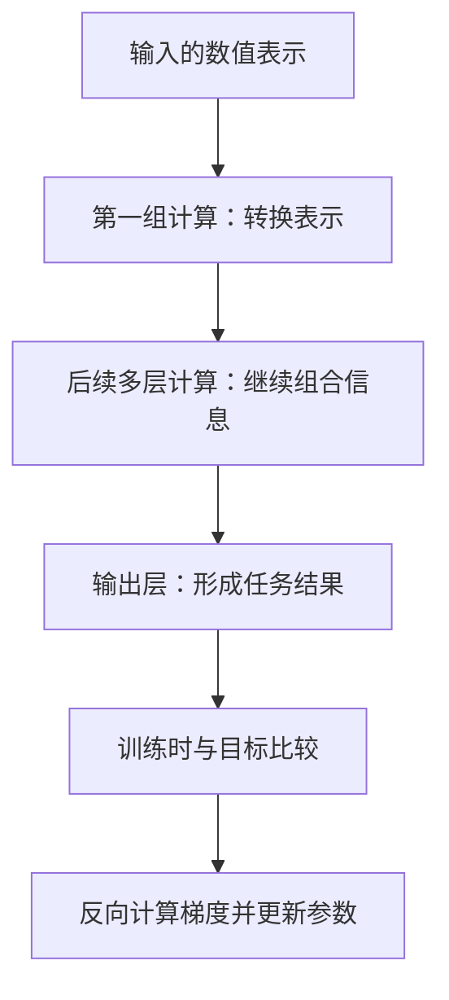

> [系列导读](../00-系列导读.md) · 第 4 章：看懂模型的计算过程

在聊天界面里，我们只看到文字输入与输出。这一章开始打开中间的计算过程：先认识数值怎样在网络中流动，再解释分词、逐步生成和模型规模。

“深度学习”里的“深”，主要描述神经网络的多层结构。它不直接表示思考更深、训练更久，也不等于看过更多资料。

要理解这个词，可以先看：信息进入一个网络之后，怎样经过一层又一层的计算。

## 一、输入首先要变成数值

照片可以表示成像素数值，声音可以表示成随时间变化的信号，文字则需要经过编码，转换成模型能够计算的表示。

以图片分类为例，模型接收到的不是“这是一只猫”这句解释，而是图片对应的数值。训练希望它从这些信息中学到有助于区分类别的规律。

这里的“表示”可以先理解为：同一份信息在计算过程中采用的数值表达方式。输入经过不同层之后，表示会发生变化，但这些数值通常没有一一对应的人类命名标签。

## 二、一层里有哪些计算

用一个简化的神经元举例：

```text
先计算：z = w1 × x1 + w2 × x2 + b
再计算：h = activation(z)
```

其中，`x1`、`x2` 是输入；`w1`、`w2` 是权重；`b` 是偏置；`activation` 表示激活函数。

权重与偏置是可以在训练中调整的参数，激活函数负责对加权结果进行进一步变换。[Google 的节点与隐藏层课程](https://developers.google.com/machine-learning/crash-course/neural-networks/nodes-hidden-layers)从这类计算解释了网络结构。

为了看清关系，暂时假设 `w1 = 2`、`w2 = -1`、`b = 0.5`，输入为 `x1 = 3`、`x2 = 1`，那么：

```text
z = 2 × 3 + (-1) × 1 + 0.5 = 5.5
```

这些数字只是人工算例，没有经过训练，也不代表一个有用的分类器。它说明的是：改变输入或参数，都会影响后续计算。

如果激活函数选用一个简单的 ReLU，规则为 `max(0, z)`，这个算例的输出就是 `5.5`。真实网络还会包含更多节点和计算模块。

## 三、为什么需要激活函数

如果每一层只做线性变换和偏置相加，连续叠加仍然可以合并成一个仿射变换。仅靠增加这样的层数，不能得到我们期待的非线性表达能力。

非线性激活函数提供了关键变化，使网络能够组合出更复杂的关系。这里先掌握它的作用即可，不必在入门阶段背下所有函数公式。

输入与输出之间的处理层，常称为隐藏层。“隐藏”是结构术语，不表示这些层在技术上完全不可查看，也不代表其中藏着像人的意识。

## 四、多层结构怎样帮助完成任务

一些视觉网络里，较早的层可能对边缘、方向或纹理敏感，后面的层再组合出更复杂的特征。但不能把“第一层一定学边缘、第二层一定学零件”当作所有网络的固定分工。

更一般地说，多层结构允许模型反复转换表示，使最后的输出更适合目标任务。



图中把正向计算与训练反馈画在一起，只表示流程关系，并没有展开真实网络中的全部连接。

## 五、网络结构与训练方法是两个问题

结构说明信息如何流动、哪些计算连接在一起；训练则负责根据数据与目标调整参数。

神经网络可以通过训练调整参数。反向传播与优化算法怎样参与这个过程，放在[训练与推理](../08-理解训练微调与对齐/01-训练与推理.md)中衔接学习；这里先区分结构与训练的职责。

如果结构没有合适的数据与训练，堆很多层也不自动产生有用能力。反过来，数据很多也不能消除错误标签或不合适目标带来的问题。

因此，深度、参数量、数据规模与计算量应分别理解。它们有关联，但不是同一个指标。

## 六、Transformer 在哪里

Transformer 是一种神经网络架构，最初的论文是 2017 年的 [Attention Is All You Need](https://arxiv.org/abs/1706.03762)。注意力机制是它的重要组成部分，能够根据输入内容计算不同位置的信息如何相互关联。

理解一句“杯子没有放进盒子，因为它太大了”，需要结合上下文判断“它”指什么。这个例子可以帮助我们理解位置之间为何需要交换信息，但不意味着注意力图必然给出一份可直接阅读的语法解释。

许多主流语言模型采用 Transformer 或相关变体。Transformer 不是深度学习的全部，深度学习也并不只服务于聊天。

本篇先看清多层计算，下一篇把这个过程放回文字输入与生成。

下一篇：[分词与逐步生成](./02-分词与逐步生成.md)。
