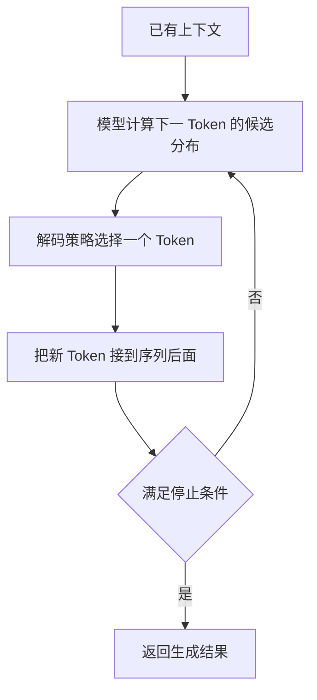

> [系列导读](../00-系列导读.md) · 第 4 章：看懂模型的计算过程

输入“今天下雨了，出门记得带……”，后面可能接“伞”，也可能接“雨衣”。一种续写是否合适，取决于前面的内容和语言规律。

语言模型研究的核心问题之一，就是语言序列及其后续内容的概率。[Google 的语言模型课程](https://developers.google.com/machine-learning/crash-course/llm)从这个角度介绍了它的基本概念。

下面主要解释常见的自回归生成式语言模型。其他语言模型可能采用不同目标和结构，不能把所有模型都简化成同一种流程。

## 一、文字先经过分词器

模型不能直接拿一段人类看到的文字进行数值运算，通常要先经过分词器，英文叫 tokenizer。

分词器把文本转换成一系列 Token，再映射为编号。模型会利用这些编号取得相应的数值表示，继续后面的计算。

```text
文字 → 分词与编码 → Token 编号 → 模型中的数值表示
```

第一章已经把 Token 作为阅读模型说明的基本单位；这里进一步看分词器与数值编码。Token 是文本处理单位。它可能对应一个字、词的一部分、完整词、标点，也可能涉及更细的字节表示；具体取决于分词方案。因此，“一个 Token 等于一个汉字”并不是通用换算规则。

同一段文字使用不同分词器，得到的 Token 数量可能不同。要知道实际切分，就应使用对应模型的分词器，而不是凭肉眼在词语之间画斜线。[Hugging Face 的分词器教程](https://huggingface.co/learn/llm-course/en/chapter2/4)给出了具体处理方式。

还要注意，Token 编号更像词表中的索引。编号为 100 的单位，不会因为比编号 50 大，就自动具有“多一倍”的含义。

## 二、一段回复怎样逐步形成

对典型的自回归模型而言，生成过程可以概括为：



这里的概率，描述的是模型在当前条件下对候选后续内容的计算结果。它不是一句话“客观为真”的概率，也不表示模型已经打开资料核对了事实。

生成会受到结束标记、输出长度限制或产品设定的其他停止条件约束。用户看到一段话逐渐出现，与这种逐步生成有关，但界面的显示方式还会受网络传输和产品实现影响。

## 三、为什么同一个问题可能有不同回答

“根据概率选择”并不总是“每次只拿概率最高的那个”。

贪心解码会在每一步选择最高概率候选；采样则按照一定规则从候选分布中选择，使输出有机会出现不同表达。温度、候选范围等设置也可能影响这个选择过程。[Hugging Face 的生成策略文档](https://huggingface.co/docs/transformers/main/en/generation_strategies)说明了这些区别。

假设让模型起草一句读书会邀请，不同措辞可能都合理。多样性在这里可能有帮助。但如果任务是从通知里提取时间，随意换成另一个时间就属于错误。

降低随机性不能补上缺失知识，也不能让一条不存在的引用变成真实来源。即使每一步都选择最高概率的 Token，最终结果仍可能出错。

另外，实际产品的模型版本、运行环境和生成配置也可能变化，不能只凭一次重复结果判断所有设置是否相同。

## 四、会续写，为什么还能回答问题

“逐步生成后续内容”描述的是生成机制。模型能够完成哪些任务，还取决于它的结构、数据与训练。

基础模型在预训练中学习语言与其他模式；后续训练可以使用指令、对话示例及其他信号，让它更适合根据要求给出回答。

在聊天场景里，不同角色的消息还会被组织成特定格式，作为 Token 序列提供给模型。模型处理的不只是最后一句话。[Hugging Face 的聊天模板文档](https://huggingface.co/docs/transformers/chat_templating)解释了角色消息怎样转换成模型输入。

因此，“预测下一个 Token”并不等于“只能做简单自动补全”。但它也没有保证所有生成内容都符合事实。任务能力与可靠程度需要分别检验。

## 五、上下文是什么

上下文可以先理解为本次生成可使用的信息，可能包括产品提供的说明、当前问题、选中的历史消息、文件片段和工具返回结果。

它与模型参数是两类东西：参数是在训练中形成的数值；上下文是这次处理时提供的信息。你把一段通知贴给模型，通常是在补充上下文，而不是即时更新参数。

上下文窗口限制模型一次能够处理的序列规模，通常以 Token 计量。输入、输出和产品内部使用的信息怎样计入额度，应查看具体模型与产品说明。

一段对话太长时，产品可能截断、摘要或检索历史记录。屏幕上还能翻到的内容，不代表模型本次仍然完整接收了它。

即使材料放得进去，能否准确找出关键句、处理矛盾并保持约束，也是另一个问题。窗口容量不能直接换算成阅读质量。

## 六、用生成机制解释一个常见现象

如果输入里写着“主持人尚未确定”，模型却输出“本次由小林主持”，它可能产生了一句语言上自然、证据上却不成立的续写。

理解生成流程的用途，是提醒我们把“说得通”和“有依据”拆开检查。可以结合第一章的[笔记整理案例](../01-认识大语言模型/06-一份笔记的整理过程.md)，回看哪些输出得到原文支持。


上一篇：[从数值到神经网络](./01-从数值到神经网络.md) · 下一篇：[参数、上下文与运行内存](./03-参数上下文与运行内存.md)。
