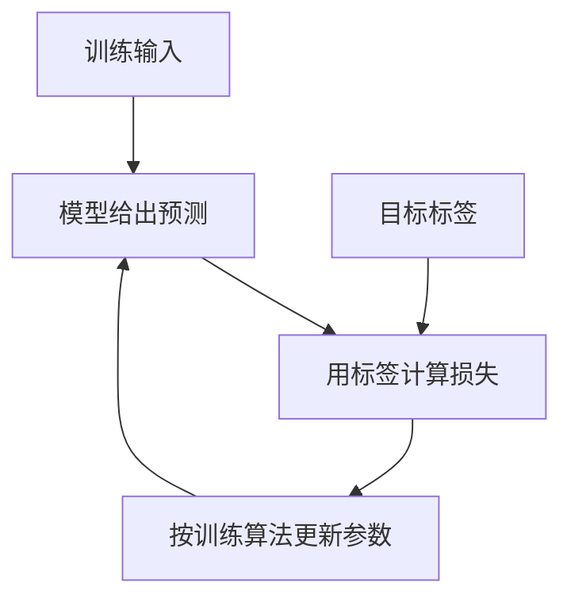

> [系列导读](../00-系列导读.md) · 第 8 章：理解训练、微调与对齐

前面调用模型、补充上下文或检索笔记，通常没有更新模型参数。现在从一个邮件分类例子出发，解释真正的训练过程，以及为什么训练后的模型还需要用新数据检验。

“让模型学习”听起来像是在教一个人。但在一个典型的训练过程中，真正发生的是：训练程序利用数据，按照目标和算法调整模型，使它在某类任务中给出更合适的结果。

我们沿用上一篇的垃圾邮件例子，看看“学习”怎样落到具体步骤上。

## 一、先说明输入和目标

假设已经收集了一批邮件，并标出了哪些是垃圾邮件、哪些是正常邮件。

| 训练样本 | 输入内容示意 | 标签 |
| --- | --- | --- |
| A | 请确认明天下午的项目评审时间 | 正常邮件 |
| B | 领取奖品前请先支付手续费 | 垃圾邮件 |
| C | 本周课程资料已上传 | 正常邮件 |

这些例子由人工编写，只用来说明任务。真实系统还需要考虑数据来源、代表性、隐私和标注质量。

“输入”是模型拿来判断的信息；“标签”是训练时提供的目标结果。利用带标签的例子学习输入与输出关系，属于监督学习。[Google 的机器学习入门](https://developers.google.com/machine-learning/intro-to-ml/what-is-ml)介绍了分类、回归等常见任务。

## 二、预测、比较，再调整

在一个常见的可微分模型训练流程里，可以把工作拆成四步：

1. 把一批输入交给模型，让它给出预测。
2. 将预测与标签比较，用损失函数计算一个反映差距的数值。
3. 根据训练算法计算参数应该怎样调整。
4. 更新参数，继续处理后续批次。



参数是模型内部参与计算的数值。它们影响模型怎样组合输入信息，也影响最终预测。对于神经网络，训练常通过梯度相关方法更新参数；其他模型的拟合方法可能不同，不能把这个循环的每一个细节都套到全部机器学习算法上。

损失也不完全等于“做错了几道题”。例如，一个分类模型即使最终都选择了“正常邮件”，对正确类别给出很低或很高的分数，训练时受到的反馈也可能不同。

还要留意一个前提：**训练目标是否真的对应我们想要的效果。** 如果标签里把诈骗邮件误标成正常，损失降低也可能是在更好地拟合错误标签。

## 三、为什么不能只检查训练邮件

如果模型把旧邮件及其标签全部记住，它可能在训练数据上表现很好，却无法可靠处理一封改写过的诈骗邮件。

把学到的规律用到未参与训练的数据，叫作泛化。过拟合则表现为模型过度贴合训练数据，新数据上的表现变差。[Google 的过拟合课程](https://developers.google.com/machine-learning/crash-course/overfitting/overfitting)说明了为什么训练成绩不能独立代表实际效果。

实际工作中，经常会把数据分成不同用途：

| 数据划分 | 主要用途 | 应避免的事情 |
| --- | --- | --- |
| 训练集 | 拟合模型、更新参数 | 把测试数据混进来 |
| 验证集 | 比较模型或选择训练设置 | 反复调到只适合这一小批数据 |
| 测试集 | 在方案确定后评估效果 | 看完结果后不断按同一份测试集修改方案 |

切分不只是随机抽几行。假如同一封邮件的复制版本同时出现在训练集和测试集中，成绩可能虚高；如果实际使用中不断出现新型诈骗，而测试集只有旧模板，也可能低估现实难度。

因此，“新邮件判断差”不一定只有过拟合一种原因，还可能涉及输入变化、标注不一致或训练数据缺少某些场景。

## 四、一次预测，和一次训练不同

训练完成后，把一封新邮件交给模型进行分类，通常叫作推理。这里的“推理”指运行已训练模型得到输出，不限于日常语言中的逻辑推理。

| 行为 | 参数通常是否更新 | 改变的主要是什么 |
| --- | --- | --- |
| 用训练数据继续拟合模型 | 是，具体取决于训练方案 | 模型参数 |
| 用已有模型判断新邮件 | 否 | 本次输出 |
| 在对话里补充一段材料 | 否 | 本次可用的上下文 |
| 产品保存用户偏好 | 不一定，常见方式并不更新参数 | 外部记录及之后提供的信息 |

实际产品可以安排后续训练，但“我刚发了一条消息”不能直接推出“模型现在已经把它学进参数”。数据会不会被保存、用于何种用途，是另一组产品与数据处理问题。

## 五、语言模型的训练目标从哪里来

不是所有训练都需要人工逐条写出答案。

在常见的自回归语言模型预训练中，文本自身就能提供预测目标。为了说明关系，把一句话粗略写成：

```text
给定：今天 / 下雨 / 了
目标：预测后面的文本单位
```

这里的斜线只是讲解用的划分，不代表真实分词器的结果。具体 Token 会在第四篇解释。

这类利用数据自身构造监督信号的方式，通常称为自监督学习。模型可以从大量序列中学习模式，而不需要为每一条都写一份人工问答。[Hugging Face 对 Transformer 的介绍](https://huggingface.co/learn/llm-course/en/chapter1/4)讨论了预训练与后续训练的基本区别。

有了基础模型，后续还可以通过指令示例或偏好等信号，改善它遵循要求、组织回答的方式。不同模型的流程并不完全一致，训练得像一个聊天助手也不等于所有回答已经获得事实保证。

把这篇的几条线索连起来就是：先定义任务与数据，再按目标训练，最后用新情况检验。下一步，我们把模型内部的结构放大来看。


本篇解释训练与推理的基本区别。后续将分别展开预训练、微调和偏好训练；如果当前任务只是让模型读取新笔记，可以先回到资料组织与检索流程，不必立即开展训练。

[返回系列导读](../00-系列导读.md)。
