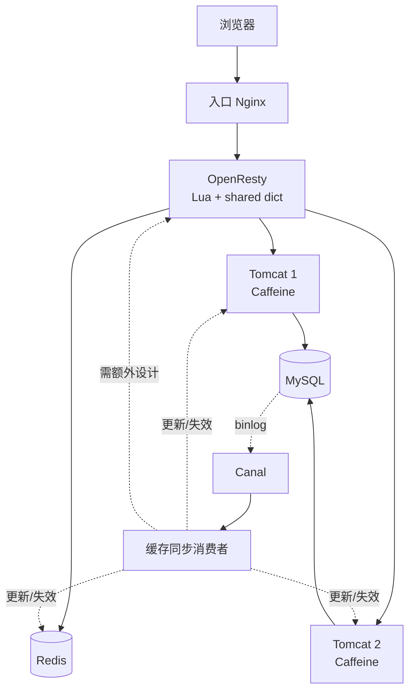

---
# 文章标题
title: Redis 多级缓存系列索引：架构、读写链路与学习路线
# 文章发布日期
published: 2026-08-03
# 文章简介
description: 汇总 Redis 多级缓存系列文章，串联 Caffeine、OpenResty、Nginx 本地缓存、Redis 与 Canal，梳理最终架构、查询链路、数据更新流程和推荐实践顺序。
# 文章标签
tags: [Redis, 多级缓存, Caffeine, OpenResty, Canal]
# 文章分类
category: Redis
# 是否为草稿
draft: false
# 是否置顶
pinned: false
# 是否允许评论
comments: true
# 文章密码
# password: 
---

## 1. 文档导航

1. [多级缓存：进程缓存整理](./多级缓存-进程缓存整理.md)  
   认识多级缓存、Caffeine、本地进程缓存及其边界。

2. [Lua 语法入门：整理与补充](./Lua语法入门-整理与补充.md)  
   掌握 OpenResty 脚本所需的 Lua 变量、类型、函数、table、模块和常见陷阱。

3. [多级缓存实战：OpenResty 与 Tomcat](./多级缓存实战-OpenResty与Tomcat.md)  
   学习 OpenResty 配置、请求参数、内部子请求、CJSON、Tomcat 集群和请求聚合。

4. [多级缓存实战：Redis 与 Nginx 本地缓存](./多级缓存实战-Redis与Nginx本地缓存.md)  
   完成 shared dict → Redis → Tomcat/Caffeine → MySQL 的查询链。

5. [缓存同步：策略选择与 Canal 实战](./缓存同步-策略与Canal.md)  
   比较同步方案，搭建 Canal，并补齐库存、OpenResty L1 和多 JVM 同步边界。

## 2. 最终架构



## 3. 一次读请求

```text
浏览器
  → 入口 Nginx
  → OpenResty shared dict
      → 命中：直接返回
      → 未命中：查询 Redis
          → 命中：回填 shared dict 后返回
          → 未命中：请求 Tomcat
              → 查询 Caffeine
                  → 命中：返回
                  → 未命中：查询 MySQL 并回填 Caffeine
```

## 4. 一次数据更新

主链：

```text
后台修改 MySQL
  → MySQL 写 binlog
  → Canal 读取事件
  → Java Handler
  → 更新 Redis
  → 更新当前 JVM 的 Caffeine
```

## 5. 推荐练习顺序

1. 启动两个 Java 实例，验证相同 URI 的哈希路由。
2. 在 OpenResty 中完成商品和库存的 Tomcat 聚合。
3. 启动 Redis，执行预热并验证 key。
4. 加入 shared dict，观察首次和再次请求的命中层级。
5. 修改 MySQL 商品表，观察 Canal → Redis/Caffeine。
6. 在 OpenResty L1 未过期时再次请求，观察旧值窗口。
7. 补充库存表处理器并重复验证。
8. 设计能覆盖所有 JVM 和 OpenResty 节点的失效消息。

## 6. 核心结论

- 多级缓存的价值是逐层吸收流量，不是层级越多越好。
- 越靠近用户的缓存越快，但同步和失效越困难。
- TTL 是兜底，不是完整同步方案。
- Canal 负责捕获数据库变化，消费者才真正决定缓存如何收敛。
- 命中率、延迟和一致性必须一起观测。
